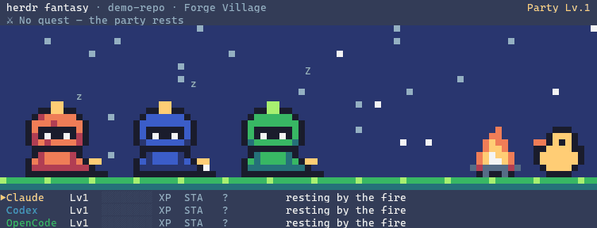

# herdr fantasy

Your coding agents as a fantasy RPG party, living in a [herdr](https://herdr.dev) pane.
While agents work they fight slimes and bosses that mirror what they're really doing;
when one needs you it raises its hand and talks to you in a JRPG dialogue box. Each repo
grows its own party, levels, quest log and town.



Every animation is real: an edit swings a sword (damage = lines written), `grep` reads a
book, `git push` sends a carrier pigeon, a skill opens a spellbook, `cargo test` summons a
boss that laughs when it fails, subagents rise from shadow as Joke Class summons, and a
filling context window makes heroes tired until they rest (compaction).

Runs on Linux, macOS and Windows. Everything stays local: no network, no telemetry; agent
transcripts are only ever read.

## Install

Needs a Rust toolchain (`cargo`), because herdr builds the plugin on install.

```sh
herdr plugin install KantaKan/herdr-fantasy
```

The stage opens by itself at the bottom of every workspace (`auto_open` in the config
changes that). Try it without herdr: `herdr-fantasy stage --demo`.

Rich animations (tools, bosses, stamina, summons) come from Claude Code transcripts.
herdr's own Claude integration must be installed (`herdr integration status`; install with
`herdr integration install claude`). Other agents get status-level heroes.

## Talk to the agent that needs you

Plugins can't bind keys, so add this to your herdr `config.toml`, then run
`herdr server reload-config`:

```toml
[[keys.command]]
key = "prefix+a"
type = "plugin_action"
command = "kantakan.herdr-fantasy.open-ask"

# optional: show/hide the party
[[keys.command]]
key = "prefix+shift+p"
type = "plugin_action"
command = "kantakan.herdr-fantasy.toggle-stage"
```

When a hero shows ❗, press `prefix+a`: `▶ Go to this agent` jumps to its pane,
`Next agent` cycles if several are waiting, `Esc` closes. The popup never types into
your agents.

## In the stage

Click into the stage pane, then: `t` town · `q` quest log · `c` character sheet ·
`←/→` pick a hero · `Enter` jump to its agent · `?` help · `Esc` back · `Ctrl-C` quit.

## Config

`$HERDR_PLUGIN_CONFIG_DIR/config.toml` (print it with `herdr plugin config-dir
kantakan.herdr-fantasy`). Every key is optional; see `SPEC.md` §9 for the full list.

```toml
auto_open = "every_workspace"   # every_workspace | first_workspace | off
notify_on_blocked = true
notify_sound = "request"        # none | done | request
memes = true                    # the Rubber Duck and other Quips
reduced_motion = false          # no dashes, hops, shakes, flashes or fades
store_prompt_text = true        # false: the quest log keeps only a hash of your prompts

[classes]                       # agent kind → Knight, Mage, Rogue, Ranger, Cleric, Bard,
claude = "Sahur Knight"         #   or the specials "Sahur Knight" / "Wild Card"

[pets]                          # a pet that follows the hero: cat, dog, dragon, owl
claude = "dragon"
```

`herdr-fantasy doctor` prints what it detected (socket, config, renderer).

## Performance

Measured with `herdr-fantasy stage --demo --scenario stress --bench` (8 heroes acting
every 80–250 ms, back-to-back bosses and summons), release build, Windows 11 + Windows
Terminal inside herdr, 60 s:

| | measured | budget (SPEC §8.5) |
|---|---|---|
| CPU | 0.34% of one core (process), 0.65% (loop's own timing) | < 3% in battle |
| Memory | 15.3 MB peak RSS | < 30 MB |
| Frame | 0.5 ms average, 4.9 ms worst | — |

The live stage with one real Claude agent and its transcript: 0.7% of one core, 16 MB.
Hidden stages draw nothing.

## Development

`SPEC.md` (what and why), `TASKS.md` (milestones), `ART.md` (art bible), `CONTEXT.md`
(glossary), `docs/adr/` (decisions). Placeholder art is generated from shapes by
`tools/gen_*.py`; the README GIF by `tools/make_gif.py`. On Windows a running stage locks
the `.exe` — rename it aside before `cargo build --release`.
